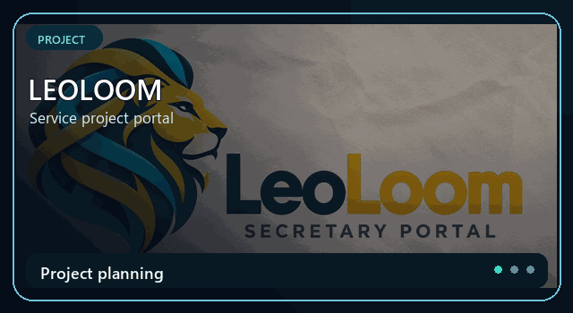
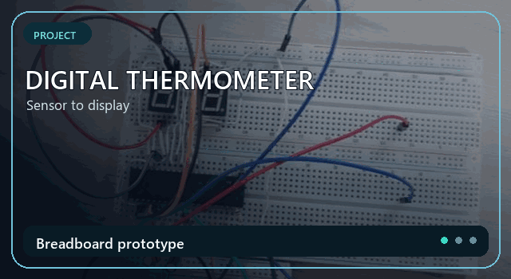
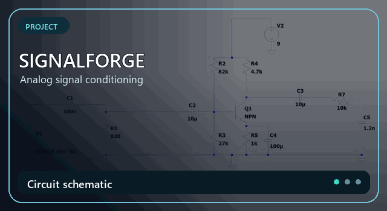
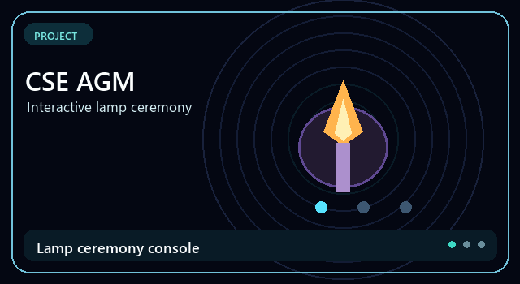
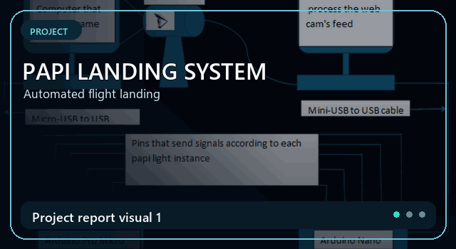

  

  
  &nbsp;&nbsp;
  
  &nbsp;&nbsp;
  
  &nbsp;&nbsp;
  
  &nbsp;&nbsp;
  

## Featured projects

Click a moving preview to open its project repository. The CSE AGM preview is an illustration; the other previews use project images.

  
  

  
  

  
  

  

## Tools and technologies

**Programming and web:** Java, JavaScript, TypeScript, HTML, CSS, Spring Boot, REST APIs  
**Electronics and design:** Proteus, EasyEDA Pro, digital logic, analog circuits, PCB design  
**Data and deployment:** SQLite, PostgreSQL, Vercel

  

